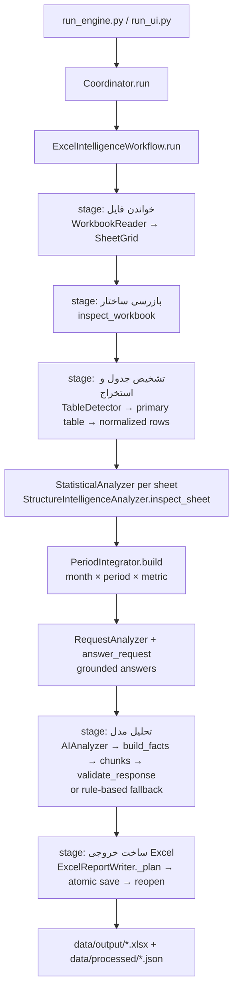

# Local Office AI — Phase 0 Baseline Audit (READ-ONLY)

|  |  |
| :--- | :--- |
| Repository | `https://github.com/hamedfallahi00120-cmyk/works` |
| Commit audited | `6df6256` — `main`, merge of PR #2 `ci/python-dependency-bootstrap` (shallow clone) |
| Audit date | 2026-11-27 |
| Environment | Linux container, Python 3.13.15 (`/usr/local/bin/python`) |
| Change footprint | **zero** — `git status --porcelain` empty before and after; no branch created; no dependency installed; no repository file modified |

## 0. Evidence rules and status legend

Every claim below is either executed in this environment or quoted verbatim from the source at
commit `6df6256` with `path:line`. Persian strings are quoted exactly as they appear.

| Tag | Meaning |
| :--- | :--- |
| **[V]** | Verified — read in source at the cited line, or executed here |
| **[PV]** | Partially verified — mechanism exists but is limited, untested, or only some paths are covered |
| **[NV]** | Not verified — cannot be executed here (missing asset, missing dependency, Windows-only, external service) |
| **[M]** | Missing — no code path exists |
| **[F]** | Failed / defective — code path exists and is demonstrably wrong |

### 0.1 What could not be executed, and why

| Check | Result | Evidence |
| :--- | :--- | :--- |
| `python -m pytest` | **[NV]** | `ModuleNotFoundError: No module named 'pytest'`; also `openpyxl`, `PySide6` missing. Installing is out of scope for Phase 0. |
| End-to-end run on the three failure files | **[NV]** | `data/input/` contains only `.gitkeep`; the three files are not in the repository. |
| Live Ollama / Qwen analysis | **[NV]** | No Ollama endpoint in this environment. |
| GPU counters, autostart, Tk window, real Qt rendering | **[NV]** | Windows-only; the project documents this itself. |
| Syntax / import-graph integrity | **[V]** | `python -m compileall -q src tests` → exit `0`; AST scan of third-party imports matches the declared requirements. |

Consequence: **all findings about the known failure are code-trace findings, not reproductions.**
They are labelled as such. No claim of "it works" or "it fails at runtime" is made beyond what
the code states.

---

## 1. Verified repository baseline (Task 1)

### 1.1 Is the complete project source present? — **[V] Yes**

| Metric | Value |
| :--- | :--- |
| Tracked files | 137 |
| `src/**.py` | 76 files / 29,365 lines |
| `tests/**.py` | 27 files / 4,227 lines / 209 test functions |
| Docs | 8 markdown reports |
| Legacy | `legacy/Ollama_Excel_Assistant_V4_2.py` (1,887 lines) + its `.bat` |
| Entry points | `run_engine.py`, `run_ui.py`, 4 `.bat` launchers, `Deploy_Update.bat` |

The import graph is closed. The only non-stdlib imports in `src/` are `openpyxl` (14 files),
`PySide6` (22 files), `psutil` (2), `docx`/`pptx`/`pdfplumber`/`PIL`/`pytesseract` (1 file,
`ingestion/reader.py`) — all declared in `requirements.txt` or `requirements-documents.txt`.
`compileall` over `src` + `tests` exits `0`.

**A committed ZIP snapshot exists at the repo root**: `Local-Office-AI_UI_UX_Refined.zip`
(470,865 bytes). Diff against the working tree:

| Category | Result |
| :--- | :--- |
| ZIP entries | 130 |
| Only in ZIP | — (none) |
| Only in repo | `requirements-dev.txt`, the four `data/*/.gitkeep` files, the ZIP itself |
| Content differs | `AGENTS.md`, `README.md`, `pytest.ini`, `requirements.txt`, `tests/conftest.py`, `tests/test_packaging.py` |
| `src/` differences | **none** — engine and UI source are byte-identical |

So the ZIP is a stale packaging artifact, not an extra source of truth. It should not be
committed (it doubles the repo size and creates two revisions of the same docs).

### 1.2 Are the UI/UX Refined files integrated? — **[V] Yes**

`docs/ui_ux_refined_report.md` lists 16 changed files. All exist and are the ones imported by
`run_ui.py`:

`ui/desktop/{theme,components,chrome,icons,source,results,formatting,main_window,app,ui_settings}.py`,
`ui/desktop/pages/{home,file_analysis,folder_analysis,chat,settings}.py`, `config/ui_settings.json`.
The forbidden `QGraphicsDropShadowEffect` / `QGraphicsOpacityEffect` on pages/cards is absent
(consistent with the documented Windows black-box defect).

### 1.3 Is MultiFormat functionality present? — **[PV] Present, but only half-wired**

Present:

- `ingestion/reader.py` — `DocumentReader` with `_read_csv`, `_read_text`, `_read_docx`,
`_read_pptx`, `_read_pdf`, OCR fallback; `SUPPORTED_DOCUMENT_SUFFIXES`.
- `ingestion/statistics.py` — `profile_table` (header-keyword identifier/date exclusion).
- `app/document_set_workflow.py` — `DocumentSetWorkflow.scan` (≤100 files, skips
`reference`/`~$`), per-file extraction, optional single multi-source AI call.
- `excel/mixed_report_writer.py` — mixed workbook (`خلاصه اجرایی`, `فهرست منابع`, statistics,
extracted tables, extracted text).
- UI: multi-file source card + `DocumentSetWorker`; `tests/test_multiformat_ingestion.py`.

Limits (each verified in code):

1. **No CLI entry point.** `ui/cli.py` imports only `Coordinator` and `FolderWorkflow`;
`--file` goes through `WorkbookReader` (Excel only) and `--folder` through
`FolderWorkflow.scan`, which returns workbooks only. Multi-format is GUI-only.
1. **No cross-file period merge.** `DocumentSetWorkflow` stores per-file `months`/`periods`
strings (`document_set_workflow.py:188-192`) but never calls `PeriodIntegrator` merge.
`FolderWorkflow._merge` does merge — but for Excel only. Two different orchestration
engines with different capabilities.
1. **Output is always Excel** (see §6).

### 1.4 Is LHM hardware monitoring integrated? — **[PV] Yes, Windows-only path unverified**

- `ui/desktop/hardware.py:310` → `LHM_REST_URL = "http://127.0.0.1:8085/data.json"`;
`_flatten_lhm_payload` walks the LHM JSON tree; `IS_WINDOWS = os.name == "nt"`.
- `ui/desktop/workers.py:481` `HardwareWorker(QThread)` emits `snapshot`/`failed`;
`chrome.py:411` creates it; the floating widget reuses the same monitor (no second sensor
implementation — as the docs claim).
- `monitoring/resource_monitor.py` is a separate psutil sampler; its Windows GPU path uses
PowerShell `Get-Counter` (`resource_monitor.py:334`), not `typeperf` as `AGENTS.md` states.
- Tests: `tests/test_lhm_rest.py` (real LHM payload fixture, `monkeypatch` for the HTTP call),
`tests/test_floating_monitor.py` (8 tests, offscreen).

**Not verified:** real LHM service, real GPU temperature/VRAM, tray, always-on-top, autostart.

### 1.5 Original structure and legacy preserved? — **[V] Yes**

`legacy/` keeps the untouched V4.2 script and launcher; no module was deleted relative to the
ZIP snapshot; the V4.2 compatibility tests still exist (`tests/test_workflow_v42.py`,
`test_calculator_v42`-style figures) and are gated by the `requires_sample` marker.

### 1.6 Requirements / configuration consistency — **[PV] Mostly consistent, five defects**

| # | Finding | Evidence |
| :--- | :--- | :--- |
| C1 | Test-count drift across documents | `README.md` and `AGENTS.md` say **216** collected; `docs/MODERN_UI.md:230` says **207**; actual count is **209 test functions** (parametrisation not executed here). |
| C2 | `docs/MODERN_UI.md` §10 limitation #1 is stale | It says «تحلیل چند فایل پراکنده در رابط وجود ندارد», but `ui/desktop/main_window.py` + `state.py` support multi-file sources and `DocumentSetWorker` runs them. |
| C3 | GPU documentation drift | `AGENTS.md` says Windows GPU counters use `typeperf`; the code uses PowerShell `Get-Counter` (`resource_monitor.py:334-360`). |
| C4 | `requirements-dev.txt` is not in the deployment manifest | `Deploy_Update.bat`/`DEPLOY.md` copy only the three entry files + `src`/`config`; a deployed target cannot run `Run_Tests.bat` without a manual pip install. |
| C5 | Typo in the chart keyword | `_OUTPUT_HINTS["chart"]` contains `"char"` (`request_analyzer.py:86`). The matcher is word-bounded (`re.search(r"(?<!\w)…(?!\w)")`, `:281`), so the English word `chart` never matches; only the Persian keywords work. |

Also: no `pyproject.toml`/`setup.py`; the package is imported via `sys.path` injection in every
entry script. That is workable but means no `pip install -e .`, no console entry points, and no
static dependency metadata.

### 1.7 Missing modules or assets — **[M]**

| Asset | Status | Impact |
| :--- | :--- | :--- |
| `data/input/Book2_AI_V4_2_Monitored.xlsx` | missing | 26 test functions (`requires_sample`) cannot run; V4.2 regression coverage is dark |
| `reference/v5_sample_report/` | missing | design-reference comparison impossible |
| `5ماهه تصادفات.xlsx` | missing | known failure cannot be reproduced |
| `شهريار 5 ماهه 1405.xlsx` | missing | known failure cannot be reproduced |
| `دیییییی.docx` | missing | Word-reuse defect cannot be reproduced |
| `logs/` | absent from repo (present in ZIP) | harmless; created at runtime |
| `pyproject.toml` | missing | no installable package metadata |

---

## 2. Architecture map (Task 2)

### 2.1 Entry points — **[V]**

| Entry | File | Path into the engine | Notes |
| :--- | :--- | :--- | :--- |
| Headless CLI | `run_engine.py` → `ui/cli.py::main` | `Coordinator.run` / `FolderWorkflow.run` | `--file`, `--folder`, `--request`, `--output`, `--audit`, `--check-structure`, `--list-models`, `--image` |
| Modern desktop | `run_ui.py` → `ui/desktop/app.py::main` | `MainWindow` → `AnalysisWorker` / `DocumentSetWorker` / `FolderWorker` → `Coordinator` / `DocumentSetWorkflow` / `FolderWorkflow` | `--floating`, `--floating-only`, Qt `qtbase_fa` translation |
| Legacy GUI | `Run_Local_Office_AI_GUI.bat` → `ui/wizard.py` | `Coordinator` via `UiBridge` | lazy Tk import; rollback path |
| Launchers | `Run_Local_Office_AI.bat`, `_GUI.bat`, `_Modern.bat`, `Run_Tests.bat` | — | project `venv` only |
| Deployment | `Deploy_Update.bat` | — | code-only manifest enforced by `tests/test_deploy_manifest.py` |

### 2.2 Layer map — **[V]**

| Layer | Modules | Responsibility |
| :--- | :--- | :--- |
| Core | `core/settings.py`, `models.py`, `logging_config.py`, `exceptions.py` | JSON-overridable `Settings`, dataclasses, UTF-8 rotating log, error types |
| Excel read/inspect | `excel/reader.py`, `workbook_inspector.py` | `WorkbookReader` (rejects corrupt/old/large/locked), sheet metadata, formulas, merged/hidden/error cells |
| Excel extraction | `excel/data_extractor.py`, `normalization.py` | `DataExtractor.extract_normalized_rows` → typed rows (`Decimal`/text/date) with per-cell `Provenance`; formula errors kept as strings; `normalize_digits`/`normalize_text` |
| Document readers | `ingestion/reader.py`, `ingestion/statistics.py` | xlsx/csv/txt/docx/pptx/pdf; PDF text+tables via `pdfplumber`, OCR only for pages with neither (`page.to_image()` → `pytesseract`, Persian pack required); `profile_table` with its own identifier/temporal keywords |
| Table detection | `excel/sheet_analyzer.py`, `table_detector.py` | `SheetGrid`, regions, header bands (multi-level, merged), header scoring, table build/termination, column profiling + roles |
| Structural intelligence | `excel/structure_intelligence.py`, `period_integration.py` | per-sheet intelligence (title, month, years, conflicts, row roles, coverage, audits, column totals), month × period × metric matrix |
| Statistics | `excel/statistical_analysis.py` (`StatisticalAnalyzer`, line 451), `anomaly_detection.py`, `validation.py`, `generic_report.py` | type-aware descriptive stats, frequencies, groups, crosstabs, trend, correlation, outliers, 9-check quality; `generic_report.py` supplies the report-sheet mixins |
| Domain (optional) | `excel/calculations.py`, `reconciliation.py` | loan/obligation figures, declared-total audits, institution matching (`Reconciler`) |
| Request QA | `ai/request_analyzer.py`, `excel/data_qa.py` | Persian intent (scope/metrics/years), grounded answers per metric |
| AI | `ai/ollama_client.py`, `context_builder.py`, `prompt_manager.py`, `response_validator.py`, `analyzer.py` | Ollama HTTP, fact package + trimming, prompts, number whitelist validation, model-or-fallback |
| Reporting | `excel/report_writer.py`, `request_report.py`, `generic_report.py`, `folder_workflow.py::FolderReportWriter`, `excel/mixed_report_writer.py` | sheet planning (`_plan`), atomic write + reopen check, RTL/format |
| Orchestration | `app/workflow.py`, `coordinator.py`, `folder_workflow.py`, `document_set_workflow.py` | stage timing, abort/timeout, single-file / folder / mixed-source runs |
| UI | `ui/cli.py`, `ui/wizard.py`, `ui/event_bridge.py`, `ui/desktop/**` | CLI, Tk rollback, PySide6 RTL UI, QThread workers, signals |
| Monitoring | `monitoring/resource_monitor.py`, `performance_report.py`, `ui/desktop/hardware.py` | psutil sampler, GPU counters (Windows), LHM REST bridge, floating widget |

### 2.3 Single-file execution flow — **[V]** (stage names are the real `_stage()` labels)



Key facts:

- Python computes every figure before the model is called; the model receives a **fact
package**, never the workbook.
- `report_profile` defaults to `clean`; `audit` adds traceability sheets.
- The processed JSON sidecar (with raw cells) goes to `data/processed/`, never next to the report.
- Order is enforced in code: `_analyze` sets `analysis.integration` (`workflow.py:315`) and
`analysis.request_answers` (`:326`) **before** the `تحلیل مدل` stage at `:127`, so the model can
only phrase numbers Python already produced.

#### 2.3.1 Prompt construction and context management — **[V]**

1. `build_facts(analysis, settings)` produces a fact package (period analysis, request answers,
per-column statistics, quality, gaps). `period_analysis` and `request_answers` survive every
trimming stage because they are normally what the request needs.
1. `context_builder` splits the package into chunks (≤ `max_ai_sheets_per_chunk = 3` sheets per
chunk) under `max_ai_context_chars = 9_000` / `max_ai_prompt_chars = 11_000`.
1. Before every HTTP call the prompt is measured against `ollama_num_ctx = 8_192` with a reserved
output budget; oversized prompts are trimmed instead of relying on a 400 + retry.
1. `validate_response(allowed_numbers=…)` (`context_builder.py:832`) flags any number the model
produced that Python did not; flagged numbers are reported, not silently accepted.
1. Per-chunk failures are recorded (`stages`) and the rule-based summary is used, so a dead model
degrades the narrative, never the figures.

#### 2.3.2 Ollama / Qwen integration — **[V]**

- `ai/ollama_client.py` talks HTTP to `ollama_base_url` (`http://127.0.0.1:11434`), with
`ollama_connect_timeout_seconds = 8`, `ollama_timeout_seconds = 300`, `ollama_retries = 2`,
`ollama_temperature = 0.1`.
- Model discovery is by prefix, not by hard-coded name: `model_name_prefixes = ["qwen3.5", "qwen3", "qwen2.5"]` (`config/settings.json`), so the newest installed Qwen wins; `--list-models` prints
what is available.
- A `health()` probe distinguishes "Ollama down" from "model answered badly"; both end in the
rule-based fallback with the reason recorded in `ai.error`.
- **Not verified here:** any live call (no Ollama endpoint in this environment).

### 2.4 Folder flow — **[V]**

`FolderWorkflow.run` → `scan(folder)` (workbooks only) → per file `ExcelIntelligenceWorkflow`
→ `_merge` (renames every source to `file::sheet`, refuses to merge a month owned by two files,
records the duplicate as a warning) → `FolderReportWriter.build_folder` (`خلاصه پوشه`,
`فهرست فایل‌ها`, `مقایسه فایل‌ها`, `موارد نیازمند بررسی`) → one `.xlsx`.

### 2.5 Mixed-source flow — **[V]**

`DocumentSetWorkflow.run(paths)` → `scan` (≤100 unique files, sha256 dedupe) → per file
`DocumentReader.read` + `profile_table`; Excel files additionally `ExcelIntelligenceWorkflow.analyze_only`
→ one optional `_ask_model` call over concatenated per-file contexts → `MixedReportWriter.build`
→ `.xlsx`. **No period merge, no per-file narrative, no Word output.**

### 2.6 UI architecture — **[V]**

- `MainWindow` (RTL) with pages: home, file analysis, folder analysis, chat, settings, results,
previous reports; shared `SourceListCard` + `RequestComposer`; sidebar with 68 px icon rail.
- Workers are `QThread`s (`AnalysisWorker`, `FolderWorker`, `DocumentSetWorker`,
`HardwareWorker`); only signals cross to the main thread; no widget access from workers.
- Legacy Tk path uses `UiBridge` (`Queue` + `Event`) and `root.after`.
- Theme/font: `theme.py` palette + QSS, `fonts.py` discovery (bundled → Vazirmatn → B Nazanin →
Tahoma), `ui_settings.json` persistence.

### 2.7 Logging and error handling — **[V]**

- `configure_logging`: `RotatingFileHandler` (5 MB × 5, UTF-8) + stderr handler, `logs/local_office_ai.log`.
- Typed errors: `EngineError`, `AIOutcome`/`AIServiceError`, `ProcessingAborted`, `UsageError`.
- CLI catches `EngineError` (exit 1), `UsageError` (exit 2) and a last-resort `Exception` with log path.
- Model failure never aborts the run: chunk errors are recorded in `stages` and the rule-based
summary is used (`analyzer.py` `_offline`).
- Every output is written atomically (temp + `os.replace`) and reopened for verification.

### 2.8 What is *not* wired — **[M]**

| Capability | Status |
| :--- | :--- |
| CLI access to multi-format documents | missing (GUI only) |
| Output-format negotiation (Word/PDF/Excel) | missing |
| DOCX/PDF report writer | missing |
| Cross-file period merge for mixed sources | missing |
| Template-based document generation | missing |

---

## 3. Investigation of the known failure (Task 3)

### 3.1 Reproduction status — **[NV]**

The three files named in the handover are **not in the repository**, and the engine cannot be
executed here (no `openpyxl`). Therefore this section traces each symptom to the exact code path
and states confidence. Nothing below is presented as a reproduced runtime result.

### 3.2 Symptom → root cause matrix

| # | Reported symptom | Root cause(s) | Confidence |
| :--- | :--- | :--- | :--- |
| S1 | Repeated Excel table blocks not recognised | **R2** (only one table per sheet is consumed), **R3** (substring total labels truncate blocks), **R1** (blocks carry month in a title/label, not in a column header) | High for R2/R3 (code-proven); medium for the exact file shape |
| S2 | Identifiers and codes classified as statistical measures | **R4** (year/month/day and code columns get no role), **R5** (duplicate-role demotion) | High (code-proven + executed keyword probe) |
| S3 | Unreliable summary statistics | Consequence of S1+S2, plus **R3** and **R7** | High |
| S4 | Aggregated and detailed rows not reconciled | **R6** (no group/subtotal model; table stops at the first total row; detail rows below it are never summed) | High (code-proven) |
| S5 | Old Word content reused instead of a new report | **R8** (no DOCX writer; the extracted text is copied verbatim into `متن استخراج‌شده`; with no model only a counter paragraph is produced) | High (code-proven) |
| S6 | Excel produced when Word was required | **R8** (no format intent, no writer, `.xlsx` hard-coded) | High (code-proven) |

### 3.3 Root causes in detail

#### R1 — The period label comes only from column sub-headers; the month only from sheet name/title **[F]**

```python
# excel/sheet_analyzer.py:765-769 (profile_columns_from_band)
profile.parent_header = cell.parent
profile.sub_header = cell.sub
profile.period = cell.period
```

```python
# excel/structure_intelligence.py:507
intel.month, intel.month_index = month_from_text(grid.sheet_name, intel.title)
```

```python
# excel/period_integration.py:503-508
month = getattr(sheet, "month", "") or ""
month_index = getattr(sheet, "month_index", None)
if not month or month_index is None:
    if sheet.column_totals:
        integration.excluded_sources.append(sheet.sheet)
    continue
```

```python
# excel/period_integration.py:521
if not metric or not period or letter == "":
    continue
```

Consequences (each follows directly from the three guards):

1. A sheet named `5ماهه تصادفات` or `شهريار` contains **no Jalali month word**, so
`month_from_text` returns `""` → the sheet is dropped from the monthly matrix entirely,
regardless of how good its table is.
1. A sheet that is *one month of one year* (a single value column, year only in the sheet name
or file name) has `column.period == ""` → every column is skipped at line 521.
The monthly matrix therefore works only when each value column carries its own year in the
header band — the multi-year pair (`1403 | 1404`) is the common case, but a single `1404`
sub-header also satisfies it. That is exactly the shape the test fixture builds:
`tests/test_output_quality.py:39-55` writes `sheet["D5"] = str(int(year) - 1)` / `sheet["E5"] = str(year)`.
1. The **file name is never parsed** for year/month (`extract_periods([grid.sheet_name])` only,
`structure_intelligence.py:508`). `شهريار 5 ماهه 1405.xlsx` cannot supply 1405 from its name.
1. Month row labels are not used either: a sheet with rows `فروردین…مرداد` and one value column
has no month and no period → excluded.

When the matrix is empty, `analysis.integration` is `None`, so `answer_request` falls back to
`_generic_answers` — three descriptive rows of **one** primary table (`excel/data_qa.py:382-407`).
That is the mechanism behind "unreliable summary" and "monthly structure not detected" for a
five-month workbook.

#### R2 — Only one primary table per sheet is ever consumed **[F]**

Detection does find multiple blocks (`table_detector.py:77` advances `position` past each table and
`_row_is_repeated_header` starts a new table), and `tests/test_workflow_generic.py:76-103` proves
two blocks in one sheet are detected. But everything downstream uses **one** table:

```python
# app/workflow.py:278
sheet_primary = self.select_best(sheet_tables)
```

```python
# app/workflow.py:502
return max(usable, key=score)
```

```python
# excel/structure_intelligence.py:501, 517
intel.columns = list(primary.columns)
intel.column_totals, intel.column_references = self._column_totals(
    grid, primary, known_sheets or {grid.sheet_name}
)
```

`PeriodIntegrator` then reads `sheet.column_totals` — i.e. only the winning block. So for a sheet
holding five monthly blocks with identical headers, **four blocks are silently absent from every
number in the report** (totals, ranking, comparison, charts, narrative). The report does not say
that other blocks were ignored.

Verdict: for stacked blocks the engine does not "fail to recognise" them; it **detects and then
discards** them. That distinction matters for the fix: aggregation must be added, not detection.

#### R3 — `is_total_label` matches substrings, so ordinary labels become "totals" **[F]**

```python
# excel/sheet_analyzer.py:28, 31-36
TOTAL_KEYWORDS = ("جمع", "مجموع", "کل", "total", "sum", "grand total", "جمع کل")

def is_total_label(text: object) -> bool:
    ...
    value = normalize_text(normalize_digits(text)).lower().strip(" :.-")
    return any(keyword in value for keyword in TOTAL_KEYWORDS)
```

Executed probe with the real helper (this environment, `normalize_text`/`normalize_digits` imported
from the repository):

| Label | `is_total_label` |
| :--- | :--- |
| `جمعیت` | **True** |
| `کلاسه پرونده` | **True** |
| `تکلیف` | **True** |
| `کلانتری` | **True** |
| `جمع کل تصادفات` | True (correct) |
| `مشتمل` | False |

This predicate is used for table termination (`table_detector.py:140`), for row roles
(`structure_intelligence.py:158` inside `row_role_from_label`), and to skip key-value rows.
A single row labelled `کلانتری …` that is followed by a blank line, a subtotal, or a differently
shaped row therefore **ends the table** (`_row_is_total` only survives when the next row has the
same shape, `table_detector.py:242-250`), and any row after the table labelled `کلانتری …` is
classified as `total` and excluded from measures.

Note the inconsistency: the statistics channel uses a safer predicate
(`excel/statistical_analysis.py:1236-1241`, exact match or `startswith(("جمع ", …))`), while the
structural layer uses the substring one. Two definitions of "total row" coexist.

#### R4 — Year / month / day and bare code columns have no semantic role **[F]**

```python
# excel/sheet_analyzer.py:45-49
(
    ColumnRole.DATE,
    ("تاریخ", "سررسید", "مهلت", "date", "due", "deadline", "تاریخ سررسید"),
),
```

There is no keyword for `سال`, `ماه`, `روز` in any role list, and `_is_identifier`
(`statistical_analysis.py:644-664`) knows only `("کد", "شناسه", "شماره", "ردیف", "id", "code", "number")`
plus a "1..n consecutive" heuristic. Executed probe of the real role table:

| Header | Assigned role |
| :--- | :--- |
| `سال` | **UNKNOWN** |
| `ماه` | **UNKNOWN** |
| `روز` | **UNKNOWN** |
| `سال تصادف` | **UNKNOWN** |
| `ماه وقوع` | **UNKNOWN** |
| `شهرستان` (numeric codes) | **UNKNOWN** |
| `کد شهرستان` | ID |
| `شماره پرونده` | ID |

Asymmetry worth noting: the **document** path already implements this rule —
`ingestion/statistics.py:12`
`_TEMPORAL_WORDS = ("تاریخ", "روز", "ماه", "سال", "زمان", "ساعت", "date", "day", "month", "year", "time")`
— and `profile_table` skips those columns. The rule exists in the codebase; it is simply not
applied to Excel columns. That makes P1-6 a port, not a new concept.

UNKNOWN numeric columns become `NUMERIC_MEASURE` (`sheet_analyzer.py:975-995`), and
`SheetIntelligence.measures` includes `UNKNOWN`/`NUMBER`. The result: `جمع سال` (a meaningless
sum of 1403+1404), `میانگین ماه` ≈ 3, and a Pearson correlation between "year" and every real
measure. The generic calculation layer only excludes `IDENTIFIER`/`TEMPORAL_KEY`
(`excel/calculations.py:449`), so a mislabelled column is summed there too.

#### R5 — Duplicate-role demotion converts a second code column into a measure **[F]**

```python
# excel/sheet_analyzer.py:932-950
# Keep only one column per exclusive role; duplicates become AMOUNT/UNKNOWN.
...
    else:
        profile.role = ColumnRole.UNKNOWN
        demoted = profile
```

With two code columns and no parent/period header, the weaker one becomes `UNKNOWN`; because its
data type is `NUMBER`, it is then promoted to `NUMERIC_MEASURE` (`sheet_analyzer.py:991`). A
demotion intended to avoid two "ID" roles ends up inventing a measure.

#### R6 — No aggregate ↔ detail reconciliation; the table ends at the first total row **[F]**

```python
# excel/table_detector.py:140
if self._row_is_total(grid, row, first_col, last_col):
    break
```

```python
# excel/structure_intelligence.py:622
elif table.first_data_row <= row <= table.last_data_row:
    role = ROW_DATA if has_number else ROW_DATA_MISSING
```

Consequences:

- A table `detail rows → جمع جزء → more detail rows → جمع کل` is cut at `جمع جزء`. The rows below
are outside `first_data_row..last_data_row`, so they are **not** in `column_totals`, not in
`measures`, not in coverage, not in the statistics.
- Everything *inside* the data range is `ROW_DATA` regardless of its label, so a subtotal row that
survives `_row_is_total` is counted as an observation.
- `_audits` compares each declared total cell against the column total of that same range
(`structure_intelligence.py:1011`: `total = sum(values, ZERO) if values else None`), i.e. against
the rows above the total only. There is no grouping key, no `sum by group`, and no hierarchy in
the data model (`TableCandidate` has rows/columns only).
- When the declared total covers the whole sheet, the audit reports `mismatch` (or
`not_verifiable`), which is honest but not a reconciliation. No test covers this case
(`grep -rn "partial|subtotal|جمع جزء" tests/` → no match).

#### R7 — "Derived sheet" detection is a single switch: any cross-sheet formula **[PV]**

```python
# excel/structure_intelligence.py:977-993
def _references(self, grid, table, known_sheets):
    ...
    return bool(references), references
```

```python
# excel/period_integration.py:498-501
if getattr(sheet, "derived", False):
    integration.excluded_sources.append(sheet.sheet)
    continue
```

One `=SUM('فروردین'!D6:D36)` cell anywhere in the primary table marks the whole sheet as derived
and removes it from the monthly matrix — even if the sheet is a genuine detail sheet that merely
references one cell. Conversely, a summary sheet whose values were **pasted** (no formulas) is
never flagged as derived, and `_aggregate` (`structure_intelligence.py:1377-1413`) cannot
compensate: it buckets by `(metric, period)` and drops a second sheet only when it reports the
*same month* (recorded as `overlaps`). A pasted summary that carries no month is skipped silently
(`month_index is None`), and one that carries a different label is added as another month. Either
way the sheet is never named in the report as a summary/derived sheet, so the reader cannot tell.
That is the "duplicate counting" risk that remains open.

#### R8 — No Word output path at all; the old document text is re-emitted verbatim **[F]**

```python
# ai/request_analyzer.py:83  (the complete output-intent vocabulary)
_OUTPUT_HINTS = { ... }   # table_only, dashboard, chart, management, audit, report  — no format
```

```python
# core/settings.py:90-96
def output_path_for(self, source: Path, suffix: str = "_AI_Intelligence") -> Path:
    candidate = self.output_dir / f"{stem}{suffix}.xlsx"
```

```python
# app/document_set_workflow.py:246, 395-397
output_path = Path(output) if output else self._default_output()
...
target = self.settings.output_dir / f"گزارش_چندمنبعی_{stamp}.xlsx"
```

```python
# excel/mixed_report_writer.py:28-46
def build(self, result: Any, output: Path | str) -> Path:
    workbook = Workbook()
    ...
    workbook.save(temp)
```

```python
# excel/mixed_report_writer.py:210-218
def _text(self, wb: Workbook, result: Any) -> None:
    ws = wb.create_sheet("متن استخراج‌شده")
    ...
    for source, location, text in result.extracted_text:
        ws.cell(row, 1, source)
        ws.cell(row, 3, text)
```

And when the model is unavailable:

```python
# app/document_set_workflow.py:382-393
return (
    f"از {len(result.files)} منبع، {len(successful)} منبع با موفقیت خوانده شد. "
    ...
    "برای تفسیر مدیریتی و نتیجه‌گیری معنایی، اتصال مدل محلی باید فعال باشد."
)
```

So the deliverable for a request like "update this Word report with the new Excel data" is:
an `.xlsx` file named `گزارش_چندمنبعی_*.xlsx` whose `متن استخراج‌شده` sheet contains the **old**
Word paragraphs verbatim, plus a counter sentence. That is precisely "old Word content reused
instead of a new report", and precisely "Excel produced when Word was required".

Additional risk, verified by code shape: `--output report.docx` is accepted
(`output_path = Path(output)`), then `openpyxl` writes an XLSX ZIP under a `.docx` name. Word
cannot open it. There is no suffix validation anywhere on the output path.

### 3.4 What the engine does correctly (counter-evidence)

To keep the diagnosis honest, these behaviours are implemented and tested (tests not executed
here, but the assertions exist and the code matches them):

- Multi-year **column** workbooks: monthly matrix, period comparison, ranking, incomplete-month
exclusion (`tests/test_output_quality.py:144-158`).
- Incomplete month → excluded from period totals and flagged, never zero-filled.
- Metadata conflicts (sheet name vs title year) reported, never resolved arbitrarily.
- Declared totals audited against Python sums with cell addresses; mismatches never auto-corrected.
- Identifiers `ردیف` and `تاریخ` excluded from stats (`tests/test_structure_intelligence.py:123-137`).
- No empty loan sheets in generic workbooks; clean profile has no telemetry sheets.

### 3.5 Predicted behaviour on the three files (explicitly a prediction) — **[NV]**

| File | Expected engine behaviour given R1–R8 | Why |
| :--- | :--- | :--- |
| `5ماهه تصادفات.xlsx` | If months are **sheets** named only by month → matrix built only if each value column carries a year sub-header; if months are **blocks/rows** inside one sheet → no month, no period, no matrix; only one block analysed | R1, R2 |
| `شهريار 5 ماهه 1405.xlsx` | Year 1405 available only in the file name is ignored; if sheet names lack a year, `period` is empty and every column is skipped | R1 |
| `دیییییی.docx` | Read, text dumped verbatim into the mixed workbook; no new Word document; narrative is a counter sentence when Ollama is off | R8 |

These predictions must be confirmed in Phase 1 with the real files (see §7.4).

---

## 4. Data integrity architecture (Task 4)

| Capability | Status | Evidence | Remaining gap |
| :--- | :--- | :--- | :--- |
| Table boundary detection | **[PV]** | `table_detector.py:120-200`: regions from content runs, header scoring (`score_header`), break on 2 blank rows / total row / repeated header / low fill ratio / label-value row | A subtotal ends the table instead of splitting it (R6); substring total labels (R3); blocks separated by a single blank row are merged into one table |
| Multi-level headers | **[V]** | `sheet_analyzer.py::detect_header_band`, `HeaderCell.parent/sub/period`, merged parent extended to the last child column; `profile_columns_from_band` (765-790) keeps `parent_header`/`sub_header`/`period` | Only the band of the *primary* table is profiled |
| Repeated table blocks | **[PV]** detection / **[M]** aggregation | `table_detector.py:77` + `_row_is_repeated_header`; `tests/test_workflow_generic.py:76-103` asserts 2 blocks detected | Only `select_best` block is analysed (R2); no per-block period, no block-level totals, no "N blocks found" note in the report |
| Semantic column classification | **[V]** | `assign_roles` + `assign_statistical_roles`, header+content, conflict reasons (`table.reasons`, `warnings`) | Role vocabulary has no `سال`/`ماه`/`روز` (R4) |
| Identifier vs numeric measure | **[PV]** | `_is_identifier` (header keywords + unique ratio ≥ 0.9), `_is_sequential_identifier`, `is_temporal_key`; `calculations.py:449` skips `IDENTIFIER`/`TEMPORAL_KEY` | Non-consecutive codes, numeric `شهرستان`, year/month/day columns become measures (R4); duplicate demotion (R5) |
| Aggregate / subtotal detection | **[PV]** | Row roles `total/difference/percentage/note/footer` (`structure_intelligence.py:154-168`); declared-total audits with cell addresses; `_matches_partial_sum` distinguishes "partial sum" | No group key → no subtotal-per-group; no reconciliation of detail vs aggregate; subtotal cuts the table (R6) |
| Duplicate-counting prevention | **[PV]** | Month de-duplication across sheets (`_aggregate`), folder `_merge` refuses a month owned by two files, sha256 dedupe in document set, duplicate rows counted not deleted | Pasted-value summary sheet is counted next to its source (R7); overlapping aggregate/detail rows in one sheet are not deduped |
| Source provenance | **[PV]** | Every audit carries `sheet!address`; `normalized_rows` keep cell addresses; `پاسخ درخواست` has a `منبع محاسبه` column; `ردیابی منبع` sheet in audit profile | `جدول ماهانه شاخص‌ها` shows recomputed values **without** per-cell addresses; clean profile has no traceability sheet; Word/PDF tables have only a page/paragraph location |
| Calculation reconciliation | **[PV]** | `_audits` declared vs computed, `verify()` re-computation, `_matches_partial_sum`, cross-sheet audits, `PeriodTotal.verification` | No aggregate↔detail reconciliation; mismatches are reported, never resolved (by design) |
| Explicit partial parsing / extraction failures | **[V]** | `SheetIntelligence.status` (`fully_analyzed`/`partially_analyzed`/`not_analyzed`), warnings, `truncated` flags on `ExtractedTable`, per-file `DocumentOutcome.status`/`error`, `DataValidator` 9 checks | Failures are surfaced in Excel; a Word report would need the same channels (not implemented) |

**Assessment.** The integrity architecture is strong at *cell and sheet* level and weak at
*block and group* level. Everything assumes: one table per sheet, one month per sheet, one year
per column band, and a single flat data range. The three failing files violate at least one of
those assumptions, which is why the numbers were unreliable even though the arithmetic itself
(`Decimal`, re-verification, no silent deletion) is sound.

---

## 5. AI and Python responsibility (Task 5)

| Responsibility | Owner | Status | Evidence |
| :--- | :--- | :--- | :--- |
| Extraction, normalisation, statistics | Python | **[V]** | `statistical_analysis.py`, `calculations.py` (`Decimal` + `Fraction` re-verification), `period_integration.py` |
| Grounded answers (ranking, comparison, quality) | Python | **[V]** | `data_qa.py::answer_request` builds every value from `PeriodIntegration`; the model only rephrases |
| Natural-language understanding of the request | Python first, model optional | **[PV]** | `request_analyzer.py` is a deterministic Persian classifier (scope/metric/year); the model is not used for intent |
| Report writing | Qwen (narrative only) | **[V]** | `prompt_manager.SYSTEM_PROMPT`: «همه محاسبات قبلاً با Python انجام شده است… هیچ عدد تازه‌ای نساز» |
| Number guard | Python | **[V]** | `response_validator.validate_response(allowed_numbers=...)`; unsupported numbers are flagged (`اعداد بدون منبع`) |
| Orchestration / output | Application | **[V]** | `workflow.py`, `coordinator.py`, `report_writer.py` |

**Verdict: the separation is correct and enforced.** The model never receives the workbook, never
receives a table it must sum, and its output cannot change a figure: sheets are written from
`AnalysisResult`, and the narrative is validated against the Python-computed whitelist
(`context_builder.allowed_numbers`).

Residual risks (not violations, but worth noting):

1. `sample_rows` (up to `max_ai_rows = 40` raw rows) **are** sent to the model. A model could
describe a pattern from those rows that Python did not compute; the validator only checks
*numbers*, not qualitative claims.
1. The model is asked for a fixed JSON schema (`summary/findings/missing_data/recommendations/ risk_level`). There is no mechanism to request a *document* (sections, headings, tables) —
which is exactly what a Word report would need.
1. Request understanding does not include output format, so "generate a Word report" is invisible
to the pipeline (R8).

---

## 6. Output generation (Task 6)

| Requirement | Status | Evidence |
| :--- | :--- | :--- |
| Understand the requested output format | **[M]** | `_OUTPUT_HINTS` (`request_analyzer.py:83-90`) has `table_only`, `dashboard`, `chart`, `management`, `audit`, `report` — no `Word`/`PDF`/`Excel`; no CLI flag; no UI selector |
| Use an existing DOCX as a formatting template | **[M]** | `python-docx` is imported only in `ingestion/reader.py` for reading (`Document(str(source))`); there is no `Document()` + `save()`, no style copy, no placeholder replacement |
| Generate new content from current source data | **[PV]** | Excel: yes (`report_writer._plan` builds sheets from `AnalysisResult`). Narrative: model or deterministic fallback. Word: no |
| Preserve RTL and Persian formatting | **[PV]** | Excel: `ws.sheet_view.rightToLeft = True` (`report_writer.py:306-307`), `FONT_NAME = "Tahoma"` (`:43`). Word: not applicable (no writer) |
| Avoid inventing unavailable statistics | **[PV]** | `None` → «در دسترس نبود» / `—`; no zero-fill; AI validator. But misclassified columns produce *wrong* (not invented) figures (R4/R5) |
| Track the source of every reported metric | **[PV]** | Audits and `پاسخ درخواست` carry `sheet!address`; `جدول ماهانه` does not; provenance sheet is audit-only |

### 6.1 The concrete Word gap

There is **no** module, class, function or CLI flag anywhere in the repository that writes a
`.docx` or `.pdf` report:

- `grep -rn "docx" src/` → only `ingestion/reader.py` (read path) and UI suffix lists.
- All three writers are `openpyxl`: `ExcelReportWriter`, `FolderReportWriter`, `MixedReportWriter`.
- Default names hard-code `.xlsx` (`settings.output_path_for`, `document_set_workflow._default_output`).
- A user-supplied `.docx` output path is not rejected — it produces a corrupt file.

Therefore "produced Excel when Word was required" is not a bug in a Word pipeline; **the Word
pipeline does not exist**. Any fix must add a format decision + a DOCX renderer that consumes the
same `AnalysisResult`/`RequestAnswer` objects (so the numbers stay Python's).

---

## 7. Testing strategy (Task 7)

### 7.1 Why the historical suite is not the right first instrument

- It cannot run here (no `pytest`/`openpyxl`), and Phase 0 forbids installing dependencies.
- 26 test functions require `data/input/Book2_AI_V4_2_Monitored.xlsx`, which is not shipped
(`pytest.ini` marker `requires_sample`). Those failures are a missing asset, not a regression.
- More importantly: **none of the six reported defects is covered by an existing test.**
Re-running 209 tests would produce a green/red number that says nothing about R1–R8.

### 7.2 Defect → nearest existing test → coverage gap

| Defect | Nearest existing test | What it does *not* check |
| :--- | :--- | :--- |
| R1 period/month source | `test_output_quality.py:39-55` builds 1403/1404 **column** pairs | single-year sheet, year in file name, month only in a title row |
| R2 repeated blocks | `test_workflow_generic.py:76-103` | only asserts `len(sales_tables) == 2`; never that both blocks reach totals/answers |
| R3 total label | `test_sheet_structure.py:155` `test_total_label_helper` (positives/negatives only) | labels containing `کل`/`جمع` as substrings (`کلانتری`, `تکلیف`, `جمعیت`) |
| R4 identifier roles | `test_structure_intelligence.py:123-137` (`ردیف`, `تاریخ`) | `سال`, `ماه`, `روز`, numeric `شهرستان` |
| R5 duplicate roles | — | no test |
| R6 aggregate/detail | — | no test (`grep -rn "partial\|subtotal\|جمع جزء" tests/` → nothing) |
| R7 derived sheets | `test_structure_intelligence.py` asserts `derived is False` | pasted-value summary sheet, single cross-sheet formula |
| R8 Word output | — | no test at all |

### 7.3 Minimal targeted validation plan (write these first, in this order)

Each test must use a **real** workbook built with `openpyxl` in `tmp_path` (repo convention: no
mocks) and must fail on the current code.

| ID | Test (suggested name) | Fixture | Assertion that must fail today | Guards |
| :--- | :--- | :--- | :--- | :--- |
| T1 | `test_all_stacked_blocks_reach_the_monthly_matrix` | one sheet, 3 blocks with the same header, one blank row between, each block = one month | every month of every block appears in `integration.months` and the metric total equals the sum of all blocks | R2 |
| T2 | `test_total_label_needs_a_word_boundary` | labels `کلانتری ۱۲`, `تکلیف`, `جمعیت`, `کلاسه پرونده`, `جمع`, `جمع کل` | first four → `False`; last two → `True` | R3 |
| T3 | `test_year_month_day_columns_are_not_measures` | table with `سال`, `ماه`, `روز`, `تعداد` | roles are temporal keys; `measures == ["تعداد"]`; no `جمع سال` calculation | R4 |
| T4 | `test_second_code_column_stays_an_identifier` | two numeric code columns, no parent header | both stay identifiers; neither enters means or correlations | R5 |
| T5 | `test_single_year_monthly_sheets_get_period_from_sheet_and_file_name` | 5 sheets `فروردین`…`مرداد`, one value column, file `X 5 ماهه 1405.xlsx` | `integration.periods == ["1405"]`, 5 months, 5 cells | R1 |
| T6 | `test_subtotal_row_does_not_truncate_detail_rows` | detail rows → `جمع جزء` → more detail → `جمع کل` | all detail rows counted once; declared grand total reconciles or is an explained mismatch; rows below the subtotal are not lost | R6 |
| T7 | `test_pasted_summary_sheet_is_not_double_counted` | monthly sheets + a summary sheet with pasted (no formula) totals | summary sheet excluded from aggregation, with a warning naming it | R7 |
| T8 | `test_word_request_produces_a_new_docx` | a `.docx` template + an `.xlsx` with new numbers, request «گزارش Word بساز» | output is `.docx`, opens with `python-docx`, contains the new figures and none of the template placeholder text | R8 |
| T9 | `test_output_suffix_is_validated` | `--output report.docx` **before** a Word writer exists | a clear `UsageError`/`EngineError` («فرمت خروجی پشتیبانی نمی‌شود») instead of a corrupt file | R8 safety |
| T10 | `test_monthly_sheet_shows_source_cells` (P2) | monthly workbook, clean profile | every monthly value row carries the source address(es) used | provenance |

T1, T5 and T6 are the three that directly reproduce the known failure and should be written first.
T8/T9 belong to the Word work package and can follow the extraction fixes.

### 7.4 One real end-to-end acceptance run (after Phase 1 fixes)

Requires the owner to place the three files in a scratch folder **outside** version control
(e.g. `F:\acceptance\`). Nothing is uploaded.

```bat
:: 1) each workbook on its own — the CLI takes exactly one --file per run (cli.py:34)
venv\Scripts\python.exe run_engine.py --file "F:\acceptance\5ماهه تصادفات.xlsx" ^
    --request "جمع و مقایسه ماه‌ها و بیشترین ماه را بگو" --no-ai --audit
venv\Scripts\python.exe run_engine.py --file "F:\acceptance\شهريار 5 ماهه 1405.xlsx" ^
    --request "شاخص‌ها را مقایسه کن" --no-ai --audit

:: 2) the two workbooks together — today only through --folder (Excel only)
venv\Scripts\python.exe run_engine.py --folder "F:\acceptance" ^
    --request "شاخص‌ها را بین فایل‌ها مقایسه کن" --no-ai

:: 3) the Word deliverable — needs the Phase-2 writer; until then it must fail loudly (T9)
venv\Scripts\python.exe run_engine.py --file "F:\acceptance\5ماهه تصادفات.xlsx" ^
    --output "F:\acceptance\out.docx" --no-ai
```

The DOCX + Excel mixed run has **no CLI entry point today** (`--file` is a single value,
`ui/cli.py:34`; multi-source is GUI-only), so criterion 4 is exercised through the desktop UI now
and through `--files` once G9 lands.

Acceptance criteria (all must hold, each checked against the produced file, not against logs):

1. `--check-structure` lists **every** block with its own address and month.
1. No identifier/year/month column appears in `آمار توصیفی` or in any sum.
1. Monthly totals equal the Python recomputation; declared totals either reconcile or are listed
in `موارد نیازمند بررسی` with the cell address and the difference.
1. The Word file opens in Word, is RTL, contains only new text, and every figure in it exists in
`پاسخ درخواست`/`ردیابی منبع`.
1. Input files are byte-identical before/after (`sha256`).

### 7.5 Commands that are safe to run now (no dependencies needed)

```bash
python -m compileall -q src tests            # exit 0 (done)
python -m pytest tests -o addopts="" -q -m "not requires_sample"   # after pip install, CI gate
```

---

## 8. Consolidated gap list

| # | Capability | Status | Priority |
| :--- | :--- | :--- | :--- |
| G1 | Aggregate every detected block on a sheet, not only the primary one | **missing** | P0 |
| G2 | Derive period from column band **or** sheet name/title **or** file name; derive month from sheet/title **or** row labels | **partial** | P0 |
| G3 | Word-boundary total labels (`کلانتری`, `تکلیف`, `جمعیت` are not totals) | **failed** | P0 |
| G4 | Output-format decision + DOCX writer + DOCX template reuse | **missing** | P0 |
| G5 | Year/month/day/code columns as identifiers/temporal keys | **partial** | P1 |
| G6 | Aggregate ↔ detail reconciliation (subtotals per group) | **missing** | P1 |
| G7 | Derived-sheet detection that neither over- nor under-excludes | **partial** | P1 |
| G8 | Provenance in the clean monthly sheet | **partial** | P2 |
| G9 | CLI access to multi-format documents | **missing** | P2 |
| G10 | Cross-file period merge for mixed sources | **missing** | P2 |
| G11 | Output suffix validation (never write xlsx under .docx) | **missing** | P0 (safety) |
| G12 | Docs/config drift + the `"char"` keyword typo (test counts, stale UI limitation, `typeperf`, dev requirements in deploy) | **defective** | P3 |
| G13 | Remove the committed ZIP snapshot; add `pyproject.toml` | **missing** | P3 |

---

## 9. Prioritized corrections

### P0 — correctness of the numbers and of the deliverable

1. **G3 — fix `is_total_label`** with the word-boundary rule the statistics channel already uses
(`statistical_analysis._looks_like_total`). One shared helper, used by table detection, row
roles and key-value detection. *Risk: low; behaviour change is observable in table boundaries,
so it needs T2 plus the existing total-row tests.*
1. **G1 — per-sheet block model.** Introduce a list of block objects per sheet (address, month,
period, column totals) and aggregate all of them; keep `primary` only for the descriptive
sheets. *Risk: medium; touches `workflow.py`, `structure_intelligence.py`,
`period_integration.py`, provenance in `report_writer`. Needs T1.*
1. **G2 — period/month inference order.** Column band → sheet name → title → file name; month from
sheet/title → block title row → first month label in the block. Every inference must record its
source string in the report (no silent guesses). *Risk: medium; can change existing totals, so
the metadata-conflict tests must stay green.*
1. **G11 — reject or convert unsupported output suffixes** before writing. *Risk: none; pure guard.*
1. **G4 — Word output (first slice).** `OutputFormat` in `WorkflowOptions`/CLI (`--format` or by
`--output` suffix); a `DocxReportWriter` that renders the **existing** `RequestAnswer` list +
executive summary + tables, RTL (`w:bidi`, `w:rtl`, Persian font), and no figure that is not in
`AnalysisResult`. Template mode (open the user's DOCX, keep styles, replace a marked region)
ships in the same slice behind a separate flag. *Risk: high (new subsystem); needs T8/T9.*

### P1 — statistical integrity

1. **G5 — role vocabulary**: add `سال`/`ماه`/`روز` (and `سال وقوع`, `ماه وقوع`) as temporal keys,
treat low-cardinality integer columns with a temporal header as keys, and never sum a temporal
key. Keep `کد`/`شناسه`/`شماره` behaviour as today.
1. **G6 — group/subtotal reconciliation**: when a block has a group column and subtotal rows,
compute per-group sums and compare each subtotal to its group; a subtotal must split the block,
not end it.
1. **G7 — derived sheets**: replace "any cross-sheet formula" with a coverage rule (share of
numeric cells that are formulas pointing to other sheets) and always report the decision.

### P2 — delivery quality

1. **G8** provenance column in `جدول ماهانه شاخص‌ها` (sheet!cell per value).
1. **G9/G10** CLI for mixed sources + period merge across documents (reuse `FolderWorkflow._merge`).
1. **Word polish**: charts/images, page numbers, table of contents, per-section source notes.

### P3 — hygiene

1. **G12** doc/config drift; **G13** remove the ZIP, add `pyproject.toml`, add
`requirements-dev.txt` to the deploy manifest (or document why not).

---

## 10. Files and modules likely to require changes

| File | Why | Risk |
| :--- | :--- | :--- |
| `src/local_office_ai/excel/sheet_analyzer.py` | `TOTAL_KEYWORDS`/`is_total_label`, role vocabulary, duplicate-role demotion | High (central) |
| `src/local_office_ai/excel/table_detector.py` | total-row termination, subtotal split, block boundaries | High |
| `src/local_office_ai/excel/structure_intelligence.py` | per-block intelligence, month/period inference, row roles, `_column_totals`, `_references` | High |
| `src/local_office_ai/excel/period_integration.py` | consume blocks, month/period fallbacks, de-duplication | High |
| `src/local_office_ai/app/workflow.py` | stop collapsing a sheet to one table; pass blocks through | High |
| `src/local_office_ai/excel/report_writer.py` | provenance columns, block summary, sheet plan | Medium |
| `src/local_office_ai/ai/request_analyzer.py` | output-format intent | Low |
| `src/local_office_ai/core/settings.py`, `app/coordinator.py`, `ui/cli.py`, `ui/desktop/{main_window,source,workers,state}.py` | format flag, output suffix guard, UI selector | Medium |
| **new** `src/local_office_ai/reporting/docx_writer.py` | DOCX renderer + template mode | Medium |
| `tests/test_sheet_structure.py`, `test_structure_intelligence.py`, `test_output_quality.py`, `test_workflow_generic.py`, **new** `tests/test_docx_report.py` | T1–T10 | Low |
| `AGENTS.md`, `README.md`, `docs/MODERN_UI.md`, `DEPLOY.md` | drift, new invariants | Low |

---

## 11. Risks and dependencies

| Risk | Impact | Mitigation |
| :--- | :--- | :--- |
| The three real files are unavailable | root causes cannot be confirmed; fixes may miss the real layout | owner supplies them to a local scratch folder; run §7.4 before/after |
| No runnable environment in this sandbox | every fix is blind | Phase 1 starts by installing `requirements*.txt` in a venv and recording the real baseline |
| Changing table boundaries alters existing V4.2 figures | regression on the loan sample (already unverifiable — sample missing) | keep `test_workflow_v42` gated; obtain the sample before changing boundary heuristics, or diff the audit profile on the real file |
| A Word writer introduces a second source of numbers | violates "Python is the only authority" | the renderer may only consume `AnalysisResult`/`RequestAnswer`; a test asserts every number in the DOCX exists in `allowed_numbers` |
| `python-docx` template mode loses user styles | user trust | open the template document object and keep its styles; never rebuild from scratch in template mode |
| Adding temporal-key roles hides real measures (e.g. `سن`) | under-counting | role requires header keyword + low cardinality + integer; test that `سن` stays a measure |
| The two orchestration engines (folder vs mixed) diverge further | inconsistent reports | Phase 2 unifies them behind one interface |
| The committed ZIP drifts from source | audits target the wrong revision | delete in P3; always state the commit SHA |

**Dependencies to add:** none. `python-docx` is already declared in `requirements-documents.txt`.

---

## 12. Recommended implementation sequence

| Phase | Scope | Exit gate |
| :--- | :--- | :--- |
| **0 (this)** | read-only audit | this report accepted |
| **1a** | environment: venv, install requirements, run `-m "not requires_sample"`, record the real baseline; add T2, T3, T4, T9 | baseline output recorded; T2–T4 red before fix, green after |
| **1b** | P0-1 (total label), P0-4 (suffix guard), P1-6 (roles), P1-8 (derived) | suite green except `requires_sample`; V4.2 expectations unchanged |
| **1c** | P0-2 + P0-3 (blocks, period inference) with T1/T5/T6 | real-file acceptance criteria 1–3 pass |
| **2** | P0-5 Word writer (new document from `AnalysisResult`), then template mode | T8 green; acceptance criterion 4 passes; every DOCX number traceable |
| **3** | P2 (provenance, CLI multi-format, merged periods) | clean profile carries provenance; mixed folder run produces one merged matrix |
| **4** | P3 hygiene + docs | docs match code; ZIP removed; `pyproject.toml` added |

Each phase: own branch, PR, test evidence in the PR body, no direct commit to `main`, no removal of
existing functionality.

---

## Appendix A — Status ledger

| Item | Status |
| :--- | :--- |
| Complete source present | **Verified** |
| UI/UX Refined integrated | **Verified** |
| Legacy preserved | **Verified** |
| MultiFormat present | **Partially verified** (GUI only, no period merge) |
| LHM integration present | **Partially verified** (Windows path unverified) |
| Requirements/config consistent | **Partially verified** (5 defects: C1–C5) |
| Missing assets | **Missing** (sample workbook, reference dir, 3 failure files) |
| Test suite executed | **Not verified** (no dependencies) |
| Known-failure root causes | **Failed** behaviours, code-proven, not reproduced |
| AI/Python separation | **Verified** |
| Word output | **Missing** |
| Excel output + RTL | **Verified** |
| Per-metric provenance in clean profile | **Partially verified** |

## Appendix B — Commands executed (evidence trail)

```text
git rev-parse --is-shallow-repository          -> true
git ls-files | wc -l                           -> 137
git status --porcelain                         -> (empty, before and after)
python -V                                      -> Python 3.13.15
python -c "import pytest"                      -> ModuleNotFoundError
python -c "import openpyxl"                    -> ModuleNotFoundError
python -c "import PySide6"                     -> ModuleNotFoundError
python -m compileall -q src tests              -> exit 0
python - <<AST scan>>                          -> openpyxl, psutil, PySide6, docx, pptx, pdfplumber, PIL, pytesseract
python - <<zip diff>>                          -> 130 entries; 6 files differ; src/ identical
python - <<is_total_label probe>>              -> جمعیت / کلاسه پرونده / تکلیف / کلانتری => True
python - <<role keyword probe>>                -> سال / ماه / روز / سال تصادف / ماه وقوع / شهرستان => UNKNOWN
```

No file inside the repository was created, modified or deleted during this audit.
This report lives outside the repository, at `/workspace/project/PHASE0_BASELINE_AUDIT.md`.

---

## Appendix C — Revision 2 (self-review corrections)

After the first pass I re-checked the report against the brief and against the source. Seven
things were wrong or under-specified; all are corrected above.

| # | What was wrong | Correction |
| :--- | :--- | :--- |
| 1 | The layer map listed `analysis/statistical_analyzer.py` — **that package does not exist** | `StatisticalAnalyzer` is `excel/statistical_analysis.py:451`; added `excel/data_extractor.py`, `anomaly_detection.py`, `validation.py` and an explicit document-reader row (§2.2) |
| 2 | R1 said the monthly matrix "only ever works for multi-year column headers" — **too strong** | a single `1404` sub-header also satisfies it; the real requirement is "each value column carries its year in the header band" (§3.3 R1) |
| 3 | The acceptance script passed `--file` twice — **invalid**, `--file` is a single value (`ui/cli.py:34`, no `action="append"`) | split into per-file runs, `--folder` for the pair, and an explicit note that a DOCX+Excel mixed run has no CLI today (§7.4) |
| 4 | Task 2 asked for "prompt construction and context management" and "Ollama and Qwen integration"; both were only named, not described | added §2.3.1 (fact package → 3-sheet chunks → 9k/11k char budget → 8 192-token check → number whitelist) and §2.3.2 (endpoint, timeouts, prefix-based model discovery, health probe) |
| 5 | Task 2 asked for "Excel extraction logic" and "Word/PDF/OCR modules"; only the readers were named | added the extraction row (`DataExtractor`, per-cell `Provenance`) and the PDF/OCR behaviour (text+tables first, `page.to_image()` → `pytesseract` only for image-only pages) |
| 6 | R7 said a pasted summary "can be counted alongside its source sheets" — **imprecise** | described what `_aggregate` actually does: `(metric, period)` buckets, month-level de-duplication recorded as `overlaps`, silent skip when there is no month, and no naming of the sheet in the report (§3.3 R7) |
| 7 | A genuine defect was missed: `_OUTPUT_HINTS["chart"]` holds `"char"`, and the matcher is word-bounded, so the English `chart` never matches | recorded as C5 in §1.6 and folded into G12 |

Two findings were added because they strengthen the analysis:

- **The temporal-key rule already exists** for documents (`ingestion/statistics.py:12`
`_TEMPORAL_WORDS` includes `سال`/`ماه`/`روز`). G5 is therefore a port of an existing rule into the
Excel role vocabulary, not a new concept — lower risk than first assessed.
- **The AI stage provably runs after the numbers** (`workflow.py:315`, `:326` set integration and
answers; `:127` is the model stage), which is the concrete evidence for the Task 5 verdict.

Brief coverage after revision: Task 1 (7/7 questions), Task 2 (14/14 areas), Task 3 (6/6 symptoms
traced), Task 4 (10/10 capabilities), Task 5 (verified), Task 6 (6/6 requirements), Task 7 (targeted
plan + one acceptance run), Deliverables 1–10 present, status legend applied throughout.

Commands added in this revision:

```text
sed -n 28,62p src/local_office_ai/ui/cli.py        -> --file is single; --folder/--request/--audit/--output exist
ls src/local_office_ai/analysis                    -> No such file or directory
grep -n "class StatisticalAnalyzer" excel/statistical_analysis.py -> 451
grep -n "def _aggregate" -A 40 structure_intelligence.py          -> (metric, period) buckets, month dedupe
grep -n "_TEMPORAL_WORDS" ingestion/statistics.py  -> line 12 includes سال/ماه/روز
grep -n "def _contains" -A 8 ai/request_analyzer.py -> word-bounded regex at :281
```


